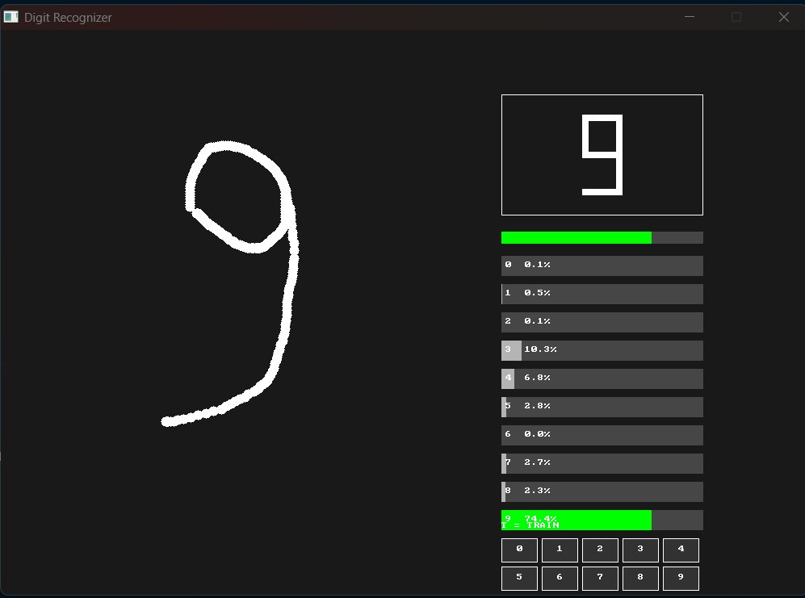

# NeuralNet-C

A handwritten digit recognizer built from scratch in **C**, using a fully custom neural network and an **SDL3 graphical interface**.

The project recognizes handwritten digits from **0 to 9**, using the MNIST dataset for training and a custom GUI for drawing and testing digits.

<p align="center">
  
</p>

## Features

- Neural network implemented from scratch in C
- MNIST dataset support
- 784 → 64 → 32 → 10 neural network architecture
- Leaky ReLU activation
- Softmax output layer
- Cross-entropy loss
- Mini-batch training
- Model saving and loading
- SDL3 graphical interface
- Handwritten digit drawing
- Automatic image preprocessing
- Bounding box detection
- Center-of-mass correction
- Prediction confidence and probability display
- Custom drawing dataset
- Interactive training directly from the GUI
- Separate interactive model saving
- MNIST and custom-drawing evaluation

## Neural Network

The network uses the following architecture:

```text
Input        Hidden       Hidden       Output

784   →       64    →      32    →      10
28x28         neurons      neurons      digits
```

The 784 input values represent the pixels of a `28x28` grayscale image.

The final layer contains 10 outputs, one for each digit:

```text
0 1 2 3 4 5 6 7 8 9
```

The output layer uses **Softmax** to convert the network output into probabilities.

## How It Works

The complete pipeline is approximately:

```text
Handwritten digit
       ↓
SDL3 drawing canvas
       ↓
Bounding box detection
       ↓
Resize to 28x28
       ↓
Center of mass correction
       ↓
Neural Network
       ↓
Softmax
       ↓
Prediction + probabilities
```

The same `28x28` format is used by the MNIST dataset.

## Training

The network can be trained using the MNIST dataset.

The project also supports training from custom handwritten drawings.

When the user draws a digit in the GUI, they can enter training mode and select the correct digit directly from the interface.

```text
Draw digit
    ↓
Press T
    ↓
Select correct digit
    ↓
Train network
    ↓
Save interactive model
    ↓
Predict again
```

## Results

The project was tested on both MNIST and a custom handwritten dataset.

### MNIST

```text
Test samples: 10000
Correct:      9501
Accuracy:     95.01%
```

### Custom Drawings

```text
Test samples: 100
Correct:      98
Accuracy:     98.00%
```

The mixed model was trained using both MNIST data and custom handwritten examples.

## GUI

The SDL3 interface provides:

- Drawing canvas
- Digit prediction
- Confidence percentage
- Probability bars for all digits
- Clear button
- Reset prediction
- Training mode
- Digit selection buttons
- Custom image saving

### Controls

| Key | Action |
|---|---|
| `Enter` | Recognize the drawn digit |
| `C` | Clear the canvas |
| `R` | Reset prediction |
| `S` | Save the current drawing |
| `T` | Enter training mode |
| `Escape` | Exit |

During training mode, the correct digit can be selected directly using the GUI buttons.

## Project Structure

```text
NeuralNet-C/
│
├── data/
│
├── drawings/
│
├── include/
│
├── models/
│
├── src/
│   ├── activation.c
│   ├── gradient_check.c
│   ├── gui.c
│   ├── main.c
│   ├── mnist.c
│   ├── mnist.h
│   ├── model.c
│   ├── neural_network.c
│   ├── neural_network.h
│   │
│   ├── test_custom_dataset.c
│   ├── test_custom_mnist.c
│   ├── test_dataset.c
│   ├── test_image.c
│   │
│   ├── train_custom.c
│   └── train_mixed.c
│
├── README.md
└── ...
```

## Technologies

- **C**
- **SDL3**
- **GCC**
- **MNIST**
- **Windows**
- **MSYS2**

No machine-learning framework such as TensorFlow or PyTorch is used.

The neural network, training logic, forward propagation, backpropagation, activation functions and model serialization were implemented manually in C.

## Building

Make sure SDL3 and GCC are installed.

The project uses SDL3 from:

```text
C:\SDL3\SDL3-3.4.18\x86_64-w64-mingw32
```

Compile the project with:

```powershell
gcc src/main.c src/gui.c src/neural_network.c src/activation.c src/matrix.c src/mnist.c src/model.c -Iinclude -IC:\SDL3\SDL3-3.4.18\x86_64-w64-mingw32\include -LC:\SDL3\SDL3-3.4.18\x86_64-w64-mingw32\lib -lSDL3 -o neuralnet.exe -lm
```

Then run:

```powershell
.\neuralnet.exe
```

## Model Loading

When the program starts, it looks for an existing trained model.

The loading priority is:

```text
interactive_model.bin
        ↓
mixed_model.bin
        ↓
model.bin
        ↓
Train from scratch
```

This allows the model to keep learning from drawings made through the GUI.

## Custom Dataset

Custom handwritten digits are stored as PGM images:

```text
drawings/
├── 0_001.pgm
├── 0_002.pgm
├── ...
├── 9_009.pgm
└── 9_010.pgm
```

The dataset contains examples for all ten digits.

These images can be used to improve the network's performance on handwriting that differs from the original MNIST samples.

## Why I Built This

I wanted to understand how neural networks actually work instead of only using existing machine-learning libraries.

Building this project helped me learn about:

- Neural network architecture
- Forward propagation
- Backpropagation
- Gradient descent
- Activation functions
- Softmax
- Cross-entropy loss
- Model serialization
- Image preprocessing
- Dataset handling
- GUI programming with SDL3
- C memory management
- Debugging a larger C project

The project started as a simple neural network experiment and gradually became a complete handwritten digit recognition application.

## Future Improvements

Possible future improvements include:

- Better accuracy on difficult handwritten digits
- More custom training data
- Data augmentation
- Improved drawing preprocessing
- Faster training
- GPU acceleration
- More advanced neural network architectures
- Visualization of the neural network
- More detailed training statistics

## Status

**Finished**

The current version includes training, model saving/loading, MNIST evaluation, custom handwritten data, SDL3 GUI recognition and interactive training.

---

Built from scratch in C by **Lucian**.
